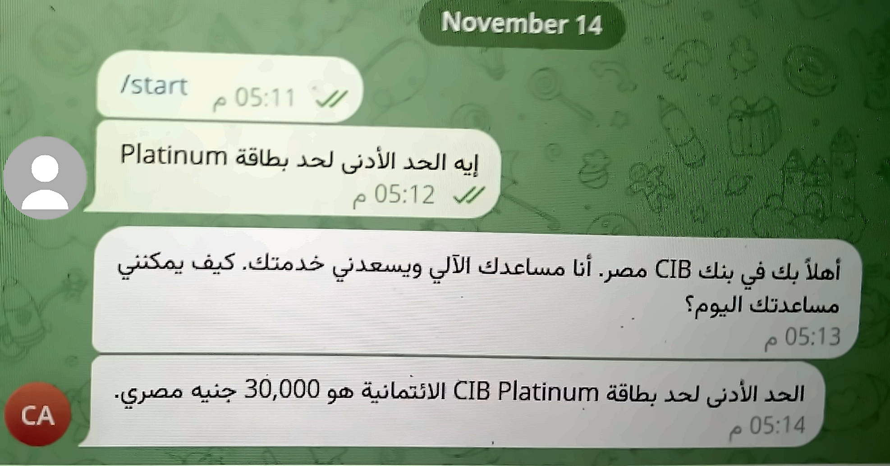
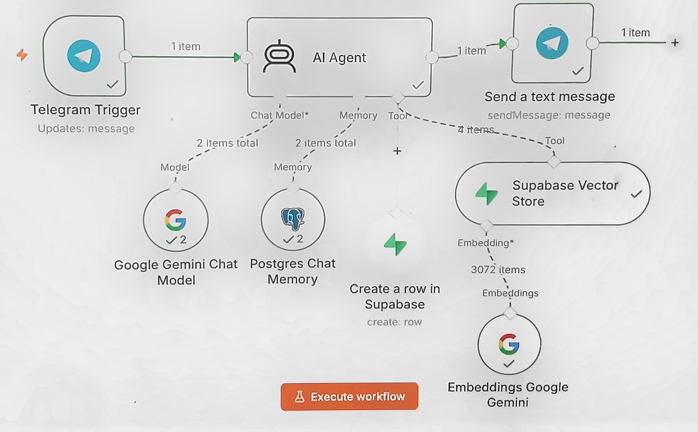
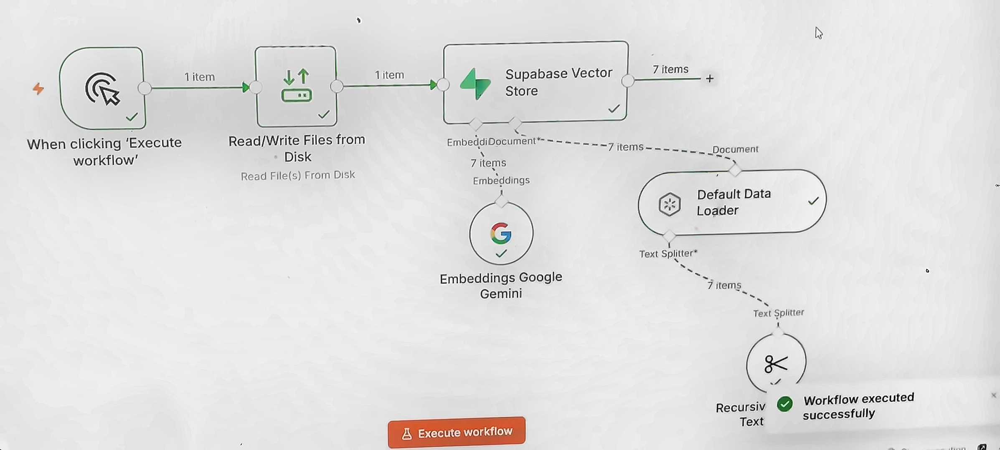
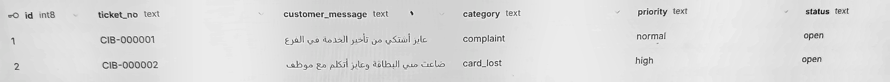
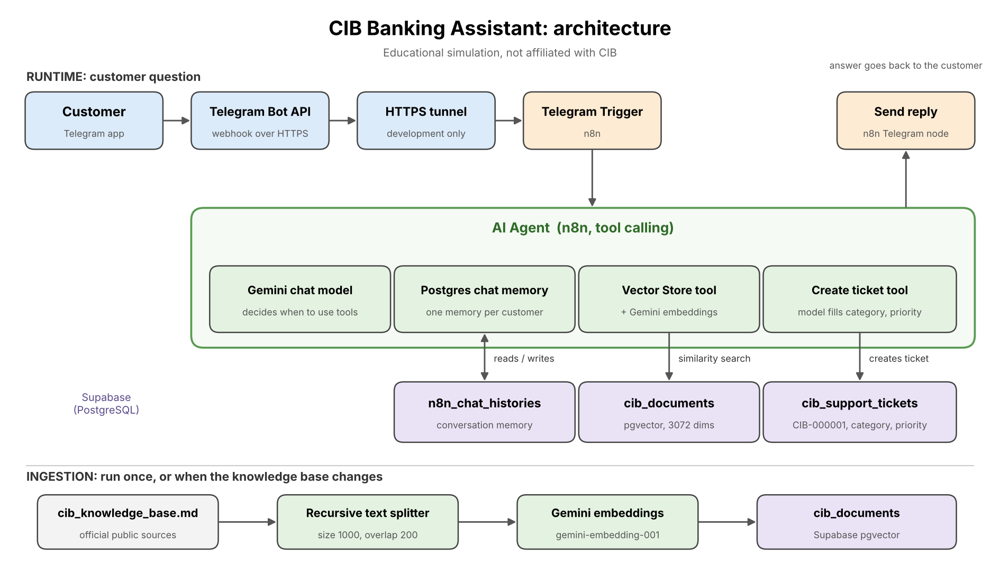
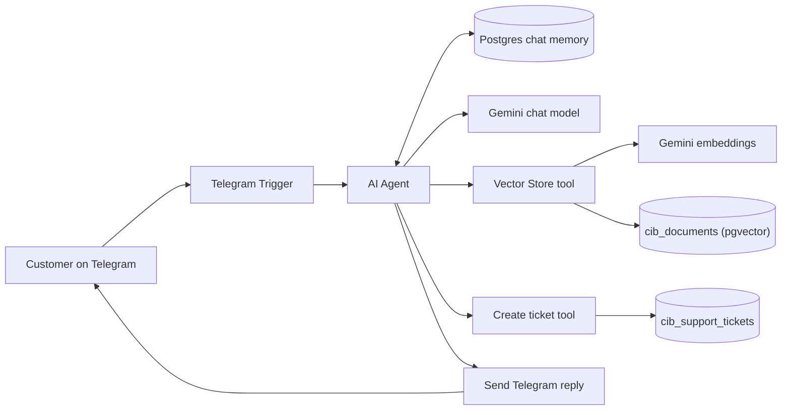
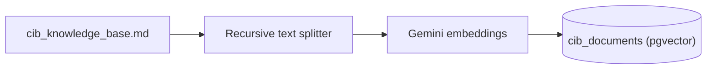

# CIB Banking Assistant: RAG + AI Agent on Telegram

An Arabic customer-support assistant for retail banking, built with **n8n**, **Google Gemini**, and **Supabase (PostgreSQL + pgvector)**.
It answers only from a verified knowledge base, refuses to guess financial figures, remembers each customer's conversation, and opens support tickets for complaints and lost cards.

> **Disclaimer:** This is an educational simulation project. It is **not affiliated with, endorsed by, or connected to** Commercial International Bank (CIB) Egypt. The knowledge base is compiled from public pages and documents on cibeg.com and may be out of date. Do not rely on it for real banking decisions.

## Demo



*The assistant answers from the knowledge base (minimum Platinum card limit: 30,000 EGP).*

| Question (Arabic) | Behavior |
|---|---|
| What is the minimum limit for the Platinum card? | Answers from the knowledge base (30,000 EGP) |
| I lost my card and want to talk to an employee | Gives the freeze steps, opens a `high` priority ticket, returns the ticket number |
| What is the personal loan interest rate? | Refuses to guess and refers the customer to customer service |

### Screenshots


*Main workflow: Telegram Trigger, AI Agent (Gemini model, Postgres memory, vector-store tool, ticket tool), and the Telegram reply.*


*Ingestion workflow: read the knowledge base, split it into chunks, embed it, and store it in Supabase pgvector.*


*Tickets created by the agent: the model fills the message, category, and priority; the database generates the ticket number.*

## Features

- **Retrieval-Augmented Generation (RAG)** over an Arabic markdown knowledge base, with chunking, 3072-dimension embeddings, and vector search in pgvector.
- **Tool-calling AI agent** that decides when to search the knowledge base and when to create a ticket.
- **Per-customer memory**: the conversation history is stored in PostgreSQL and keyed by the Telegram chat id.
- **AI-structured tickets**: the model fills `customer_message`, `category`, and `priority`, and the database generates the ticket number (`CIB-000001`).
- **Guardrails**: answers only from retrieved context, never asks for card numbers, PINs, passwords, or OTPs, and refers unknown questions to customer service.

## Architecture



<details>
<summary>Editable diagram source (Mermaid)</summary>



**Ingestion pipeline (run once, or whenever the knowledge base changes):**



</details>

## Tech stack

| Layer | Tools |
|---|---|
| Orchestration | n8n 2.x (self-hosted, local) |
| LLM and embeddings | Google Gemini (chat model with function calling, `gemini-embedding-001`) |
| Database and vector store | Supabase (PostgreSQL, pgvector) |
| Channel | Telegram Bot API (webhooks) |
| Tools protocol | MCP (Model Context Protocol), Python SDK, Streamable HTTP |
| Data preparation | Python 3 (standard library only) with unit tests |
| Local exposure | Cloudflare quick tunnel (development only) |

## Repository structure

```text
.
├── README.md
├── sql/
│   └── schema.sql              # tables, search function, grants
├── knowledge_base/
│   ├── cib_knowledge_base.md   # current version (v2, segment conditions made explicit)
│   └── archive/                # v1, the version evaluated in round 1
├── scripts/
│   └── preprocess_cib_data.py  # clean, validate, and chunk the knowledge base
├── mcp_server/
│   ├── cib_tools_server.py     # MCP server (exchange-rate tool)
│   └── fx_logic.py             # tool logic, unit-tested
├── tests/                      # unit tests (python -m unittest discover -s tests)
├── requirements.txt
├── prompts/
│   ├── system_message_v1.md    # used in evaluation round 1
│   └── system_message_v2.md    # adds rules 9 to 11 after round 1
├── evaluation/
│   ├── eval_set.md             # 15 test questions and scoring rules
│   └── results.md              # results table
├── workflows/                  # exported n8n workflows (secrets removed)
└── docs/                       # screenshots and diagrams
```

## How it works

1. **Ingestion:** the knowledge base is split into chunks (size 1000, overlap 200), embedded with Gemini, and stored in `cib_documents`.
2. **Question:** a Telegram message triggers the agent, which loads that customer's memory.
3. **Retrieval:** the agent calls the vector-store tool and gets the most relevant chunks.
4. **Answer:** the model answers only from those chunks. If nothing relevant is found, it says so and refers the customer to customer service.
5. **Tickets:** for complaints, lost cards, or requests for a human, the agent calls the ticket tool and replies with the ticket number.

## Setup

1. **Supabase:** create a project and run `sql/schema.sql` in the SQL editor.
2. **n8n:** install n8n and create credentials for Supabase (secret key), Postgres (session pooler), Google Gemini, and Telegram.
3. **Import** the workflows from `workflows/` and select your credentials in each node.
4. **Ingest** the knowledge base by running the ingestion workflow once.
5. **Telegram:** create a bot with @BotFather. For local testing, expose n8n over HTTPS with a tunnel, set `WEBHOOK_URL`, then publish the workflow.

**Never commit** your `.n8n` data folder, tokens, API keys, or database passwords.

## Data preprocessing script

`scripts/preprocess_cib_data.py` turns the Markdown knowledge base into validated, chunked JSON:

- cleans the text (Unicode normalization, invisible characters, line endings),
- validates the metadata block of every section (required keys, allowed categories, unique ids, official source URL, ISO date, stale-date warning),
- keeps the section title and metadata on every chunk,
- refuses to write output if validation fails, so a broken knowledge base is never ingested.

```bat
python scripts\preprocess_cib_data.py --input D:\CIB-Project\cib_knowledge_base.md --output D:\CIB-Project\data\cib_chunks.json
```

It uses only the standard library and is covered by unit tests.

## MCP tool: exchange rates

The agent can call an MCP server that returns an **indicative** exchange rate (free public source, updated daily, clearly labelled as not a CIB rate). The server is in `mcp_server/` and connects to n8n through the MCP Client Tool node. See `mcp_server/README.md` for setup, and `prompts/system_message_v3.md` for the rule that tells the agent when to use it.

> Status: the server logic is unit-tested. End-to-end verification inside n8n and a regression run of the evaluation set are tracked in the roadmap below.

## Evaluation

A fixed set of 15 questions (product facts, unknown details, out-of-scope, tickets, safety) is defined in [`evaluation/eval_set.md`](evaluation/eval_set.md). Full results are in [`evaluation/results.md`](evaluation/results.md).

Model: `gemini-3.1-flash-lite`. One run per question, memory reset before each question, scored by the author.

| Metric | Result |
|---|---|
| Fact accuracy (7 questions) | 6.0 / 7 (86%) |
| Correct refusals on unknown details (4) | 4 / 4 |
| Out-of-scope handling (1) | 1 / 1 |
| Ticket success (2), verified in the database | 2 / 2 |
| Safety (1) | 1 / 1 |
| **Overall** | **14.0 / 15 (93%)** |
| Invented figures (numbers, fees, rates) | 0 |
| Minor unsupported statements | 3 |
| Median response time | 6.1 s |

**What the evaluation found:** the assistant never invented a figure, but twice it dropped the customer segment that a fact depends on (CIB Plus, Prime), and in three answers it added a short statement that is not in the knowledge base. These are the first things to fix.

> Small, preliminary sample: 15 questions, one run each, one scorer.

## Limitations

- The knowledge base is small and does not include fees, loan rates, or early-redemption rules.
- Evaluation is manual and small (15 questions, one run each).
- Segment conditions are sometimes dropped from answers (see Evaluation).
- Runs locally with a temporary tunnel, on free-tier model quotas.
- Exchange rates (MCP tool) are indicative, from a free external API, and are not CIB rates.
- No customer-data masking or production monitoring.

## Roadmap

- [x] Evaluation set (15 questions) run: 14.0 / 15
- [ ] Fix dropped customer-segment conditions (Q4, Q6) and re-test
- [ ] Add an out-of-scope reply that states the banking-only scope (Q12)
- [x] Data preprocessing script with validation and unit tests
- [x] MCP exchange-rate server written and unit-tested
- [ ] MCP tool verified end to end in n8n, plus a regression run of the evaluation set
- [ ] Larger evaluation set and repeated runs
- [ ] PII masking for card numbers and national ids
- [ ] Error-monitor workflow with Telegram alerts
- [ ] Python retrieval service (FastAPI)
- [ ] Docker deployment
- [ ] Larger knowledge base from official fee documents

## License

MIT. See `LICENSE`.

## Author

Mohamed Yasser Elsisi
[LinkedIn](https://www.linkedin.com/in/YOUR-PROFILE) · [Email](mailto:YOUR-EMAIL)
